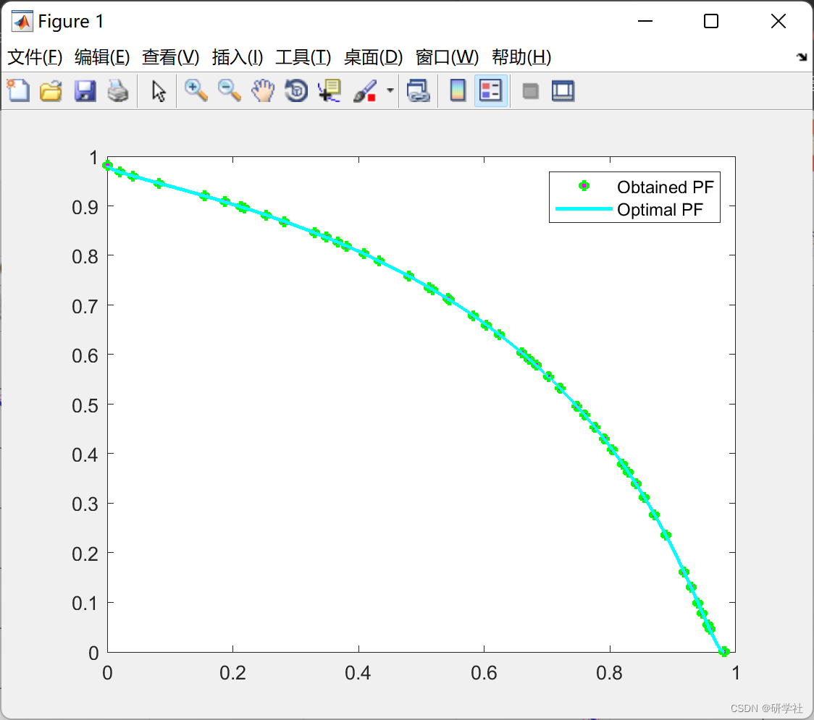
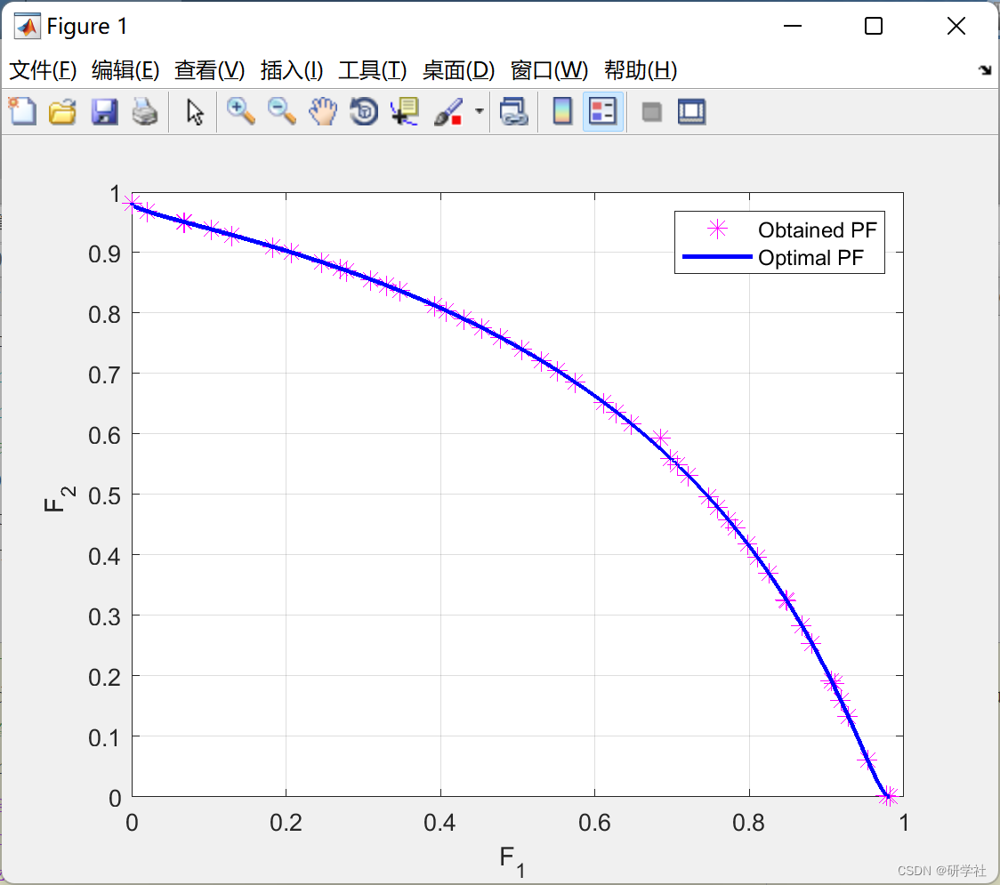

# Multi-Objective Water Cycle Optimization Algorithm (Matlab Code Implementation)

💥💥💞💞 Welcome to this blog❤️❤️💥💥
🏆 Bloggers' Advantages: 🌞🌞🌞 The content of the blog is assiduously thought-provoking and logically clear, for the convenience of readers.
⛳️ Mantra: A journey of a thousand miles begins with a single step. 1 Overview📚2 Run results🎉3 References🌈4 MATLAB Code Implementation
💥1 Overview In 2012, Hadi Eskandar and others observed the water cycle process in nature, inspired by it, they proposed the Water Cycle Algorithm (WCA). In nature, water from different places changes its state through absorbing solar energy and moving to another place. The water on the ground is evaporated by the sun or transformed into vapor by plants, which then becomes water vapor in the atmosphere. This precooled water vapor turns into small droplets due to gravity, forming rainfall that falls back to the ground. Currently, the WCA algorithm has been applied in many aspects, such as function optimization, mechanical engineering optimization, etc. Moreover, compared to other algorithms, the WCA algorithm often yields better results when optimizing these aspects, demonstrating its good ability to search for optimal solutions.
📚2 Run Results Part of the code:
tic  
N_stream=Npop-Nsr;  
NPF=Npop;  % Pareto Front Archive Size  
ind.Position=[];  
ind.Cost=[];  
ind.Rank=[];  
ind.DominationSet=[];  
ind.DominatedCount=[];  
ind.CrowdingDistance=[];  
pop=repmat(ind,Npop,1);  
for i=1:Npop  
pop(i).Position=LB+(UB-LB).*rand;  
pop(i).Cost=objective_function(pop(i).Position);
end  
[pop, F]=NonDominatedSorting(pop); % Non-dominated sorting  
pop=CalcCrowdingDistance(pop,F); % Calculate crowding distance  
pop=SortPopulation(pop);  % Sort population  
%------------- Forming Sea, Rivers, and Streams --------------------------  
sea=pop(1);  
river=pop(2:Nsr);  
stream=pop(Nsr+1:end);  
cs=[sea.CrowdingDistance';[river.CrowdingDistance]';stream(1).CrowdingDistance];  
f=0;  
if length(unique(cs))~=1  
CN=cs-max(cs);  
else  
CN=cs;  
f=1;  
end  
NS=round(abs(CN/(sum(CN)+eps))*N_stream);  
if f~=1  
NS(end)=[];  
end  
NS=sort(NS,'descend');  
% ------------------------- Modification on NS -----------------------  
i=Nsr;  
while sum(NS)>N_stream  
if NS(i)>1  
NS(i)=NS(i)-1;  
else  
i=i-1;  
end  
end  
i=1;  
while sum(NS)<N_stream  
NS(i)=NS(i)+1;  
end  
if find(NS==0)  
index=find(NS==0);  
for i=1:size(index,1)  
while NS(index(i))==0  
NS(index(i))=NS(index(i))+round(NS(i)/6);  
NS(i)=NS(i)-round(NS(i)/6);  
end  
end  
end  
NS=sort(NS,'descend');  
NB=NS(2:end);  
%%  
%----------- Main Loop for MOWCA --------------------------------------------  
disp('********** Multi-objective Water Cycle Algorithm (MOWCA)************');  
disp('*Iterations    Number of Pareto Front Members *');  
disp('********************************************************************');  
FF=zeros(max_it,numel(sea.Cost));  
for i=1:max_it  
%---------- Moving stream to sea---------------------------------------  
for j=1:NS(1)  
stream(j).Position=stream(j).Position+2.*rand(1).*(sea.Position-stream(j).Position);  
stream(j).Position=min(stream(j).Position,UB);  
stream(j).Position=max(stream(j).Position,LB);  
stream(j).Cost=objective_function(stream(j).Position);  
end  
%---------- Moving Streams to rivers-----------------------------------  
for k=1:Nsr-1  
for j=1:NB(k)  
stream(j+sum(NS(1:k))).Position=stream(j+sum(NS(1:k))).Position+2.*rand(1,nvars).*(river(k).Position-stream(j+sum(NS(1:k))).Position);  
stream(j+sum(NS(1:k))).Position=min(stream(j+sum(NS(1:k))).Position,UB);  
stream(j+sum(NS(1:k))).Position=max(stream(j+sum(NS(1:k))).Position,LB);  
stream(j+sum(NS(1:k))).Cost=objective_function(stream(j+sum(NS(1:k))).Position);  
end  
end  
%---------- Moving rivers to Sea --------------------------------------  
for j=1:Nsr-1  
river(j).Position=river(j).Position+2.*rand(1,nvars).*(sea.Position-river(j).Position);  
river(j).Position=min(river(j).Position,UB);  
river(j).Position=max(river(j).Position,LB);  
river(j).Cost=objective_function(river(j).Position);  
end  
%-------------- Evaporation condition and raining process--------------  
% Check the evaporation condition for rivers and sea  
for k=1:Nsr-1  
if ((norm(river(k).Position-sea.Position)<dmax) || rand<0.1)  
for j=1:NB(k)  
stream(j+sum(NS(1:k))).Position=LB+rand(1,nvars).*(UB-LB);  
end  
end  
end  
% Check the evaporation condition for streams and sea  
for j=1:NS(1)  
if ((norm(stream(j).Position-sea.Position)<dmax))  
stream(j).Position=LB+rand(1,nvars).*(UB-LB);  
end  
end  
🎉3 References
[2] Yao Kai. Research on Optimized Dispatch of Cogeneration Based on Multi-Objective Water Cycle Algorithm [D]. Nanchang University, 2020. DOI: 10.27232/d.cnki.gnchu.2020.001172.
🌈4 Matlab code implementation

## Images

<!-- PAYMENT_BLOCK -->

## Get this dataset

- Payment link (Stripe): [Buy now](https://buy.stripe.com/3cs8yP7sY87d0vu9AB)
- Payment QR code: 

<!-- /PAYMENT_BLOCK -->
